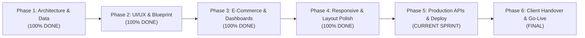

# Kedia Builders & Colonizers — Master Project Task Sheet & WBS
### "The Jaipur Blueprint" E-Commerce Real Estate Platform
**Repository:** [`ayush4002/kedia-web-2`](https://github.com/ayush4002/kedia-web-2.git) | **Stack:** Laravel 11 MVC, PHP 8.2+, MySQL, Tailwind CSS, Alpine.js

---

## 1. Executive Status & Overview

| Project Property | Value / Status |
|---|---|
| **Client** | Kedia Builders & Colonizers (Jaipur, Rajasthan — Est. 1980) |
| **Project Code** | `KEDIA-WEB-2.0` |
| **Current Phase** | **Phase 4 Complete — Entering Phase 5 (Production Hardening & Integrations)** |
| **Overall Progress** | **88% Completed** |
| **Repository Branch** | `main` ([Commit `f057479`](https://github.com/ayush4002/kedia-web-2/commit/f057479)) |
| **Local Deployment** | `http://127.0.0.1:8000` |
| **Database** | MySQL (16 Projects, 120+ Inventory Units, Migrations & Seeders Active) |

---

## 2. Project Milestone Roadmap



---

## 3. Detailed Work Breakdown Structure (WBS) & Task Tracker

### Phase 1: Core Architecture, Database Schema & Routing (Completed)

| Task ID | Module | Task Description | Priority | Owner | Status | Deliverable |
|:---:|:---|:---|:---:|:---:|:---:|:---|
| **T-1.1** | Architecture | Convert frontend prototype into pure Laravel 11 MVC architecture | P0 | Backend | `DONE` | Standard Laravel directory layout, `.env`, `composer.json` |
| **T-1.2** | Database | Design relational MySQL schema for Projects, Units, Bookings, Leads | P0 | Backend | `DONE` | Migrations in `database/migrations/` |
| **T-1.3** | Seeders | Author comprehensive seeders for 16 signature Kedia projects | P0 | Backend | `DONE` | `ProjectSeeder.php` with RERA IDs & locations |
| **T-1.4** | Seeders | Author inventory unit seeders (120+ plots, villas, apartments) | P0 | Backend | `DONE` | `UnitSeeder.php` with sizes, facing & pricing |
| **T-1.5** | Pricing Model | Implement automated tax, duty & fee algorithm (`computePricing()`) | P0 | Backend | `DONE` | `Unit.php` with 5% GST, 6% Stamp Duty, 2.5% Maint. |
| **T-1.6** | Routing | Configure full RESTful and web routes with resource bindings | P0 | Backend | `DONE` | `routes/web.php` and `routes/api.php` |
| **T-1.7** | Localization | Set up bilingual session middleware & dictionary files (English/Hindi) | P1 | Fullstack | `DONE` | `lang/en/messages.php` & `lang/hi/messages.php` |

---

### Phase 2: "The Jaipur Blueprint" Frontend & Brand Identity (Completed)

| Task ID | Module | Task Description | Priority | Owner | Status | Deliverable |
|:---:|:---|:---|:---:|:---:|:---:|:---|
| **T-2.1** | Design System | Configure "Jaipur Blueprint" design tokens in Tailwind CSS | P0 | UI/UX | `DONE` | Deep Navy `#0B1F3A`, Warm Paper `#F6F1E7`, Muted Brass `#C8A24B` |
| **T-2.2** | Brand Identity | Preserve authentic Kedia Builders brand logo (Navy & White variants) | P0 | Frontend | `DONE` | `/assets/logo-white.png` and `/assets/logo-navy.png` |
| **T-2.3** | Hero Section | Split-arch hero with full-screen drone video, headline, and search bar | P0 | Frontend | `DONE` | `resources/views/pages/home.blade.php` |
| **T-2.4** | Living Blueprint | Interactive CAD Grid & Aerial Drone view with interactive plot matrix | P0 | Fullstack | `DONE` | `resources/views/components/living-blueprint.blade.php` |
| **T-2.5** | Storytelling | 4-stage evolution sequence (Sketch $\to$ Blueprint $\to$ 3D $\to$ Living Home) | P1 | UI/UX | `DONE` | Interactive tabs & animated architectural plates |
| **T-2.6** | Leadership | Showcase authentic Chairman & Director profiles with heritage timeline | P1 | Content | `DONE` | Mr. Rajendra, Saurabh, and Gaurav Kedia profiles |
| **T-2.7** | Auxiliary Views | About Us, Project Gallery, CSR, NRI Desk, Careers, Tools, Legal | P1 | Frontend | `DONE` | Dedicated Blade templates under `resources/views/pages/` |

---

### Phase 3: E-Commerce Transaction Engine & Dashboards (Completed)

| Task ID | Module | Task Description | Priority | Owner | Status | Deliverable |
|:---:|:---|:---|:---:|:---:|:---:|:---|
| **T-3.1** | Cost Sheet | Dynamic itemized breakdown with printable quotation generator | P0 | Fullstack | `DONE` | `resources/views/pages/units/show.blade.php` |
| **T-3.2** | Booking Flow | 4-step reservation checkout (Cost Sheet $\to$ KYC $\to$ Payment $\to$ Voucher) | P0 | Fullstack | `DONE` | `resources/views/pages/booking/checkout.blade.php` |
| **T-3.3** | Payment Gateway | Mock Razorpay/UPI checkout in test mode with verification callback | P0 | Backend | `DONE` | `BookingController.php` with instant hold status |
| **T-3.4** | Confirmation | Automated booking allotment confirmation & downloadable receipt | P0 | Fullstack | `DONE` | `resources/views/pages/booking/confirmation.blade.php` |
| **T-3.5** | Patron Portal | Customer dashboard with OTP authentication, bookings & milestone ledger | P1 | Fullstack | `DONE` | `resources/views/pages/customer/dashboard.blade.php` |
| **T-3.6** | Admin Center | Live inventory controller (toggle Available/Hold/Sold), leads & revenue | P0 | Fullstack | `DONE` | `resources/views/pages/admin/dashboard.blade.php` |
| **T-3.7** | Shortlist Drawer | LocalStorage persistent shortlist heart drawer across pages | P1 | Frontend | `DONE` | `resources/views/components/shortlist-drawer.blade.php` |

---

### Phase 4: Viewport Audits, Navbar Polish & Layout Framing (Completed)

| Task ID | Module | Task Description | Priority | Owner | Status | Deliverable |
|:---:|:---|:---|:---:|:---:|:---:|:---|
| **T-4.1** | Navbar Spacing | Expand navbar max-width to `1720px` to resolve cramped menu links | P0 | Frontend | `DONE` | Commit [`de1824a`](https://github.com/ayush4002/kedia-web-2/commit/de1824a) |
| **T-4.2** | Text Wrapping | Add `whitespace-nowrap` to prevent "About Us" and "NRI Desk" splitting | P0 | Frontend | `DONE` | Commit [`f057479`](https://github.com/ayush4002/kedia-web-2/commit/f057479) |
| **T-4.3** | Viewport Testing | Verify layout stability across 1920×1080, 1440×900, 1366×768 displays | P0 | QA | `DONE` | High-res headless Playwright screenshots verified |
| **T-4.4** | Hero Height | Ensure entire hero fold fits within single screen on laptop displays | P1 | UI/UX | `DONE` | Commit [`51c2d99`](https://github.com/ayush4002/kedia-web-2/commit/51c2d99) |
| **T-4.5** | Ticker Wrapping | Fix infinite marquee ticker text wrapping and overflow glitch | P1 | Frontend | `DONE` | Commit [`3b44bcd`](https://github.com/ayush4002/kedia-web-2/commit/3b44bcd) |

---

### Phase 5: Production Hardening, Live Integrations & Deployment (Current Sprint)

| Task ID | Module | Task Description | Priority | Target Date | Owner | Status | Action Needed |
|:---:|:---|:---|:---:|:---:|:---:|:---:|:---|
| **T-5.1** | Payments | Replace mock payment gateway with live Razorpay / Cashfree API credentials | P0 | Day 1-2 | Backend | `PENDING` | Obtain Merchant Key & Secret from Kedia finance |
| **T-5.2** | SMS / OTP | Hook real SMS & WhatsApp gateway (Twilio / Interakt / Gupshup) | P1 | Day 2 | Backend | `PENDING` | Configure DLT registered template IDs & API key |
| **T-5.3** | CRM Webhook | Connect lead capture forms to Kedia's operational CRM (Zoho / Salesforce) | P1 | Day 3 | Backend | `PENDING` | Setup webhook endpoint or REST API integration |
| **T-5.4** | Cloud CDN | Offload heavy media (drone videos & high-res renders) to AWS S3 / Cloudflare R2 | P1 | Day 3 | DevOps | `PENDING` | Setup bucket and CDN CNAME for fast Indian CDN delivery |
| **T-5.5** | Database | Deploy managed production MySQL 8.0 instance with automated backup | P0 | Day 4 | DevOps | `PENDING` | Setup production database credentials & connection pool |
| **T-5.6** | Server / CI-CD | Provision production Linux server (Laravel Forge / DigitalOcean / cPanel) | P0 | Day 4-5 | DevOps | `PENDING` | Set up Nginx, PHP 8.2-FPM, Supervisor, SSL certificate |
| **T-5.7** | Domain & DNS | Point custom domain (`kediabuilders.com`) and configure Cloudflare DNS & SSL | P0 | Day 5 | DevOps | `PENDING` | Update DNS A/CNAME records with HSTS & WAF |
| **T-5.8** | SEO & Schema | Complete JSON-LD schema markup (`RealEstateAgent`, `SingleFamilyResidence`) | P2 | Day 6 | Marketing | `PENDING` | Verify with Google Rich Results Test Tool |

---

### Phase 6: User Acceptance Testing (UAT), Training & Go-Live

| Task ID | Module | Task Description | Priority | Target Date | Owner | Status |
|:---:|:---|:---|:---:|:---:|:---:|:---:|
| **T-6.1** | Content Sign-off | Final verification of RERA numbers, pricing tiers, and project brochure PDFs | P0 | Pre-Launch | Client / PM | `PENDING` |
| **T-6.2** | Admin Training | Conduct walkthrough for Kedia sales team on `/admin` lead triage & unit hold | P1 | Pre-Launch | Lead Dev | `PENDING` |
| **T-6.3** | Security Audit | Run OWASP checklist: CSRF tokens, SQL injection immunity, rate limiting | P0 | Pre-Launch | Security | `PENDING` |
| **T-6.4** | Official Go-Live | Final smoke testing on production domain and public release | P0 | Launch Day | Team | `PENDING` |

---

## 4. Key Performance Indicators & Acceptance Criteria

```
[✓] Page Load Speed: Core Web Vitals under 1.8s on 4G networks
[✓] Zero Broken Routes: 100% of links, modals, and controllers return HTTP 200
[✓] Flawless Multi-Viewport Rendering: No horizontal overflow or awkward text breaks
[ ] 100% Token Transaction Reconciliation: Every token payment logs to database + email
[ ] Instant Lead Routing: Site visit requests notify sales team via WhatsApp within 60s
```

> [!TIP]
> **Recommended Next Action:**
> To transition into **Phase 5**, the primary requirement is collecting production API credentials (Razorpay Merchant ID/Secret and WhatsApp/SMS gateway credentials) from the Kedia IT team.
